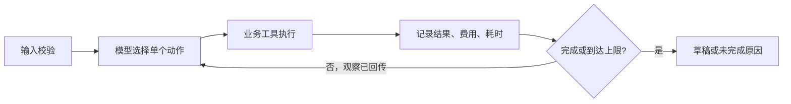

# 02 方案与技术取舍

## 调用流程

`src/cli.py` 读取 JSON 并验证必填项。`src/agent.py` 每轮让模型选择一个工具，`src/business.py` 执行并将结果与累计费用/耗时写入 SQLite；`src/models.py` 将工具观察回传 DeepSeek，模型再选择下一动作或 `finish`。流程骨架允许“先搜索、后脚本、再估算、最后保存”，具体素材、脚本替代、继续或停止由模型根据观察选择。

模型调用使用 DeepSeek Chat Completions function calling，默认 `deepseek-flash`、禁用 thinking，按次请求 `tool_choice=required`。工具调用 `reason` 是简短可审计依据，不记录私有思维。若模型一次返回并行动作，执行器拒绝整批、把拒绝结果回传模型，避免跳过依赖；该拒绝不计业务工具调用次数，但计模型决策步数。

## 成本与依赖

每个成功工具实际费用立即计入 `spent_cost`，失败的脚本生成费用为 0、耗时 10 分钟。估算以已花费用/时间、候选素材许可证费用/制作时间、保存时间相加。失败与超预算的尝试不能重置既有花费。保存时重新计算，检查成功检索、当前脚本、同一素材可行估算、预算和截止时间，防止模型绕开估算直接保存。`plan.total_cost` 是实际合成费用；`cost_summary.spent_cost` 包含已发生的工具费与保存时素材费。

## 状态、失败与重复

SQLite `runs` 表按请求内容哈希存状态；`plans` 表以同一键为主键。成功步骤在续跑时保留；失败的标准脚本可在下一步或下一次运行中改为精简脚本。保存失败返回 `incomplete`，续跑时可复用成功估算并重新保存。数据库插入在事务中执行，重复请求命中原草稿，不再计费或重复生成。如果草稿已写入但运行状态尚未同步，重复请求以 `plans` 表为准恢复保存状态。调用限制由 `--max-steps` 和 `--max-tools` 控制。

## 取舍与边界

原生 Python 实现便于展示模型决策与工具观察之间的真实控制流，避免框架隐藏动作与状态转换；标准库足以支持 CLI、SQLite 和 HTTP 调用。`MockPolicy` 只用于离线回归与故障注入，不代表模型能力。当前单机 SQLite 和合成资料适合考核演示；没有生产级并发编排、权限、真实费用结算或发布能力。
